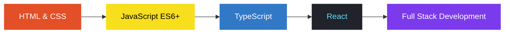

<div align="center">
  
</div>

<div align="center">


<a href="https://github.com/mahamudulxyz">
  
</a>

<br>


</div>


## 👨‍💻 About Me

```js
const mahamudul = {
  role: "Full Stack Developer (Learning)",
  education: "Engineering Student",
  location: "Bangladesh 🇧🇩",
  currentFocus: ["JavaScript (ES6+)", "TypeScript", "React", "Full Stack"],
  alsoKnow: ["Java (fundamentals)", "Python (basics)"],
  goal: "Become a professional software engineer",
  motto: "Keep learning. Keep building. Keep growing."
};
```

- 🌱 Learning full stack web development, one project at a time
- ⚛️ Exploring **React** and **TypeScript**
- 💻 Building responsive, user-friendly web applications
- 🧩 Sharpening my programming and problem-solving skills


## 🛠️ Tech Stack

**Languages**

<p>
  
</p>

**Frameworks & Libraries**

<p>
  
  
</p>

**Tools**

<p>
  
</p>


## 🚀 Learning Roadmap

<div align="center">
  
</div>




## 🎯 Goals

| Goal | Focus |
|------|-------|
| 🎓 Career | Become a professional software engineer |
| 🌐 Full Stack | Master frontend and backend development |
| ⚛️ Frontend | Build advanced React applications |
| 💙 Language | Strengthen TypeScript skills |
| 🧩 Skills | Improve problem-solving abilities |
| 🤝 Community | Collaborate with other developers |


## 📊 GitHub Stats

<div align="center">


<br><br>


<br><br>


</div>


## 📌 Featured Projects

<div align="center">

<a href="https://github.com/mahamudulxyz/portfolit-web-dev">
  
</a>
<a href="https://github.com/mahamudulxyz/first-html-project">
  
</a>

<a href="https://github.com/mahamudulxyz/card">
  
</a>
<a href="https://github.com/mahamudulxyz/assignment-no-1">
  
</a>

<a href="https://github.com/mahamudulxyz/practice">
  
</a>
<a href="https://github.com/mahamudulxyz/my-first-github">
  
</a>

</div>

> 🚧 More projects coming soon. Explore all my work on [GitHub](https://github.com/mahamudulxyz?tab=repositories).


## 💬 Daily Dev Quote

<div align="center">
  
</div>


## 🌐 Connect With Me

<div align="center">

<a href="https://github.com/mahamudulxyz">
  
</a>


<br><br>


💙 Thanks for visiting my profile!


</div>
