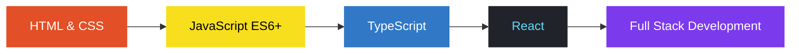

<div align="center">
  
</div>

<div align="center">


<a href="https://github.com/mahamudulxyz">
  
</a>

<br>


</div>

---

## 👨‍💻 About Me

```js
const mahamudul = {
  role: "Full Stack Developer (Learning)",
  education: "Engineering Student",
  location: "Bangladesh 🇧🇩",
  currentFocus: ["JavaScript (ES6+)", "TypeScript", "React", "Full Stack"],
  alsoKnow: ["Java (fundamentals)", "Python (basics)"],
  goal: "Become a professional software engineer"
};
```

- 🌱 Learning full stack web development, one project at a time
- ⚛️ Exploring **React** and **TypeScript**
- 💻 Building responsive, user-friendly web applications

---

## 🛠️ Tech Stack

<p>
  
</p>

---

## 🚀 Learning Roadmap



---

## 📊 GitHub Stats

<div align="center">


</div>

---

## 📌 Featured Projects

<div align="center">

<a href="https://github.com/mahamudulxyz/portfolit-web-dev">
  
</a>
<a href="https://github.com/mahamudulxyz/first-html-project">
  
</a>

<a href="https://github.com/mahamudulxyz/card">
  
</a>
<a href="https://github.com/mahamudulxyz/assignment-no-1">
  
</a>

</div>

---

## 🌐 Connect With Me

<div align="center">

<a href="https://github.com/mahamudulxyz">
  
</a>


<br><br>

**"Keep learning. Keep building. Keep growing."** 🚀


</div>
